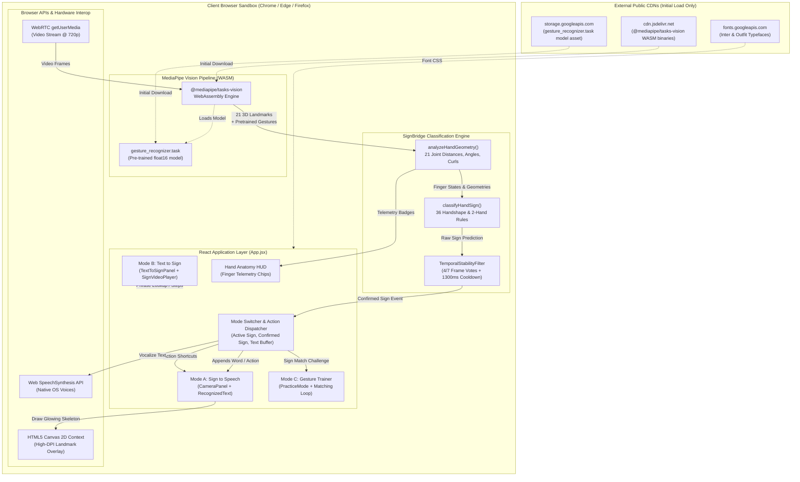
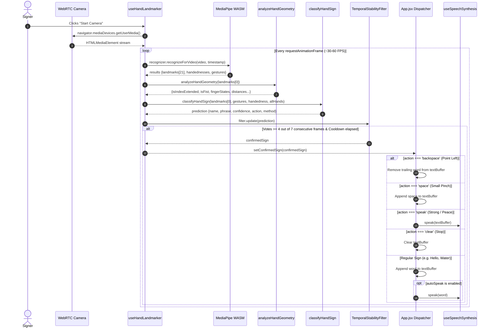

# SignBridge — System Architecture Document

**Document Version:** 1.0.0  
**Status:** Baseline Documentation  
**Product:** SignBridge — Web-Based Real-Time Two-Way Sign Language Assistant  
**Repository:** `sih` (`Warlord-06/teamname-vellosta`)  
**Audit Date:** October 2026  

---

## 1. System Overview & Architectural Boundaries

SignBridge is architected as an **entirely client-side single-page application (SPA)** built with React 19 and Vite. The system possesses **no backend server**, **no microservices**, **no server-side database**, and **no cloud-based inference endpoints**. 

All video acquisition, 3D hand joint landmark tracking, sign classification, state dispatching, and text-to-speech audio rendering occur strictly within the client browser runtime.



---

## 2. Component Structure & Module Responsibilities

| File Path | Primary Architectural Responsibility | Key Exports / Methods |
| :--- | :--- | :--- |
| [`src/main.jsx`](file:///c:/Users/MANISH%20KUMAR/OneDrive/Desktop/SIH/src/main.jsx) | Entry point; binds the React component tree into the DOM root. | Root render with `React.StrictMode` |
| [`src/App.jsx`](file:///c:/Users/MANISH%20KUMAR/OneDrive/Desktop/SIH/src/App.jsx) | Top-level application coordinator; handles mode tabs, action gesture triggers, sentence buffer state, and modals. | `App` (default component) |
| [`src/hooks/useHandLandmarker.js`](file:///c:/Users/MANISH%20KUMAR/OneDrive/Desktop/SIH/src/hooks/useHandLandmarker.js) | Encapsulates the WebRTC camera lifecycle, MediaPipe WASM model initialization, requestAnimationFrame inference loop, and track cleanup. | `useHandLandmarker()` custom hook |
| [`src/classifier/signClassifier.js`](file:///c:/Users/MANISH%20KUMAR/OneDrive/Desktop/SIH/src/classifier/signClassifier.js) | Pure geometric analysis engine, distance formulas, finger extension states, two-handed interaction logic, and temporal debouncing. | `analyzeHandGeometry`, `classifyHandSign`, `TemporalStabilityFilter`, `dist`, `dist3d` |
| [`src/hooks/useSpeechSynthesis.js`](file:///c:/Users/MANISH%20KUMAR/OneDrive/Desktop/SIH/src/hooks/useSpeechSynthesis.js) | Integrates the browser's native `window.speechSynthesis` API with rate, pitch, voice picker, and queue-cancellation logic. | `useSpeechSynthesis()` custom hook |
| [`src/data/signPhrases.js`](file:///c:/Users/MANISH%20KUMAR/OneDrive/Desktop/SIH/src/data/signPhrases.js) | Canonical dictionary of 36 sign phrases with categories, aliases, handshapes, linguistic step instructions, and lookup search algorithms. | `SIGN_PHRASES`, `findSignPhrase(query)` |
| [`src/utils/drawLandmarks.js`](file:///c:/Users/MANISH%20KUMAR/OneDrive/Desktop/SIH/src/utils/drawLandmarks.js) | HTML5 Canvas drawing routines for glowing 3D skeleton connections, bounding boxes, and anatomical finger color palettes. | `renderHandsOnCanvas`, `HAND_CONNECTIONS` |
| [`src/components/CameraPanel.jsx`](file:///c:/Users/MANISH%20KUMAR/OneDrive/Desktop/SIH/src/components/CameraPanel.jsx) | Live video preview viewport, canvas overlay, Hand Anatomy Inspector HUD, mirror toggle, skeleton toggle, and action toasts. | `CameraPanel` |
| [`src/components/RecognizedText.jsx`](file:///c:/Users/MANISH%20KUMAR/OneDrive/Desktop/SIH/src/components/RecognizedText.jsx) | Interactive translated textarea, speech synthesis controls, hands-free action gesture toggle, and gesture history breadcrumbs. | `RecognizedText` |
| [`src/components/PracticeMode.jsx`](file:///c:/Users/MANISH%20KUMAR/OneDrive/Desktop/SIH/src/components/PracticeMode.jsx) | Mode C interactive gesture challenge trainer with 5 challenge decks, 1-second hold timer, score/streak counters, and audio praise. | `PracticeMode` |
| [`src/components/GestureCheatSheetModal.jsx`](file:///c:/Users/MANISH%20KUMAR/OneDrive/Desktop/SIH/src/components/GestureCheatSheetModal.jsx) | Searchable modal directory displaying all 36 signs with handshape descriptions, steps, and 1-hand vs 2-hand badges. | `GestureCheatSheetModal` |
| [`src/components/TextToSignPanel.jsx`](file:///c:/Users/MANISH%20KUMAR/OneDrive/Desktop/SIH/src/components/TextToSignPanel.jsx) | Mode B search input, category filtering chips, and host container for `SignVideoPlayer`. | `TextToSignPanel` |
| [`src/components/SignVideoPlayer.jsx`](file:///c:/Users/MANISH%20KUMAR/OneDrive/Desktop/SIH/src/components/SignVideoPlayer.jsx) | Video playback player with play/pause, seek, slow-motion rates (0.5x–1.25x), loop, and missing-asset educational fallback guide. | `SignVideoPlayer` |
| [`src/components/QuickDemoSim.jsx`](file:///c:/Users/MANISH%20KUMAR/OneDrive/Desktop/SIH/src/components/QuickDemoSim.jsx) | Evaluation simulator card providing mock sign injection across all 36 phrases for evaluators without camera access. | `QuickDemoSim` |
| [`src/components/AboutModal.jsx`](file:///c:/Users/MANISH%20KUMAR/OneDrive/Desktop/SIH/src/components/AboutModal.jsx) | Educational modal with technical disclosures, AI transparency statements, and a full vocabulary table. | `AboutModal` |
| [`src/components/Header.jsx`](file:///c:/Users/MANISH%20KUMAR/OneDrive/Desktop/SIH/src/components/Header.jsx) / [`Footer.jsx`](file:///c:/Users/MANISH%20KUMAR/OneDrive/Desktop/SIH/src/components/Footer.jsx) | Header branding, privacy badges, footer disclaimers, and vocabulary count pills. | `Header`, `Footer` |

---

## 3. End-to-End Data Flows

### 3.1 Mode A: Camera-to-Speech Inference Pipeline
The real-time camera-to-speech pipeline executes on every animation frame:



### 3.2 Hand Landmark Preprocessing & Geometric Extraction
MediaPipe outputs 21 normalized 3D landmarks ($x, y \in [0, 1]$, $z$ relative depth scale):
- **Point 0:** Wrist joint (coordinate origin for hand orientation).
- **Points 1–4:** Thumb (CMC, MCP, IP, Tip).
- **Points 5–8:** Index Finger (MCP, PIP, DIP, Tip).
- **Points 9–12:** Middle Finger (MCP, PIP, DIP, Tip).
- **Points 13–16:** Ring Finger (MCP, PIP, DIP, Tip).
- **Points 17–20:** Pinky Finger (MCP, PIP, DIP, Tip).

#### Mathematical Formulations:
1. **2D Euclidean Distance:**
   $$\text{dist}(p_1, p_2) = \sqrt{(p_1.x - p_2.x)^2 + (p_1.y - p_2.y)^2}$$
2. **Finger Extension Check:**
   $$\text{isExtended}(i) \iff \text{dist}(\text{Tip}_i, \text{Wrist}) > 1.12 \times \text{dist}(\text{PIP}_i, \text{Wrist})$$
3. **Fingers Close Together (ASL Flat B-Handshape):**
   $$\text{fingersClose} \iff \text{dist}(\text{IndexTip}, \text{MiddleTip}) < 0.08 \land \text{dist}(\text{MiddleTip}, \text{RingTip}) < 0.08 \land \text{dist}(\text{RingTip}, \text{PinkyTip}) < 0.08$$
4. **Fingers Crossed (ASL 'R' / Good Luck):**
   $$\text{isCrossed} \iff \text{isIndexExtended} \land \text{isMiddleExtended} \land \lnot\text{isRingExtended} \land \lnot\text{isPinkyExtended} \land \text{dist}(\text{IndexTip}, \text{MiddleTip}) < 0.045$$
5. **Small Pinch ("A little bit" / Space Action):**
   $$\text{isPinchSmall} \iff \text{dist}(\text{ThumbTip}, \text{IndexTip}) < 0.052 \land \lnot\text{isMiddleExtended} \land \lnot\text{isRingExtended} \land \lnot\text{isPinkyExtended}$$

#### Classification Priority Hierarchy:
1. **Tier 1 (MediaPipe Neural Gestures — Confidence $\ge 0.65$):** Directly maps Google's pre-trained deep learning recognizer classes (`ILoveYou` $\to$ I Love You, `Victory` $\to$ Peace, `Thumb_Up` $\to$ Yes, `Thumb_Down` $\to$ No, `Pointing_Up` $\to$ Number 1, `Open_Palm` $\to$ Hello) before running heuristics to eliminate false-positive hijacking.
2. **Tier 2A (Two-Handed Coordination Signs):** Evaluates multi-hand proximity vectors (Namaste, Heart, House, Friend, Time, Applause, Help Me, All Done) with explicit handshape constraints (`hasFist && hasBasePalm` for Help Me).
3. **Tier 2B (Single-Hand Geometric Heuristics):** Evaluates 31 single-hand joint angle, curl ratio, and finger extension rules for signs outside MediaPipe's native vocabulary (e.g., ASL Numbers 3/4, Later, Okay, Call Me, Water, Food, Bathroom).

---

### 3.3 Two-Handed Spatial Interaction Pipeline
When MediaPipe detects two hands in frame (`allHandsLandmarks.length === 2`), the classifier calculates inter-hand vectors between `hand1` and `hand2`:
- **Namaste (🙏):**
  $$\text{dist}(\text{Wrist}_1, \text{Wrist}_2) < 0.22 \land \text{dist}(\text{IndexTip}_1, \text{IndexTip}_2) < 0.14 \land |\text{Wrist}_1.y - \text{Wrist}_2.y| < 0.12 \land \text{Tips Upright}$$
- **Help Me (🆘):**
  $$\text{hasFist} \land \text{hasBasePalm} \land 0.05 < |\text{Wrist}_1.y - \text{Wrist}_2.y| < 0.35 \land |\text{Wrist}_1.x - \text{Wrist}_2.x| < 0.28$$
- **Heart (🫶):**
  $$\text{dist}(\text{ThumbTip}_1, \text{ThumbTip}_2) < 0.10 \land \text{dist}(\text{IndexTip}_1, \text{IndexTip}_2) < 0.12 \land \text{Thumbs Below Tips}$$
- **House / Roof Peak (🏠):**
  $$\text{dist}(\text{IndexTip}_1, \text{IndexTip}_2) < 0.09 \land \text{dist}(\text{MiddleTip}_1, \text{MiddleTip}_2) < 0.09 \land \text{dist}(\text{Wrist}_1, \text{Wrist}_2) > 0.18$$
- **Friend (🤝):**
  $$\text{dist}(\text{IndexTip}_1, \text{IndexTip}_2) < 0.10 \land \text{dist}(\text{Wrist}_1, \text{Wrist}_2) > 0.14 \land |\text{Wrist}_1.y - \text{Wrist}_2.y| < 0.12$$
- **Time (⌚):**
  $$\text{dist}(\text{IndexTip}_1, \text{Wrist}_2) < 0.12 \lor \text{dist}(\text{IndexTip}_2, \text{Wrist}_1) < 0.12$$
- **Deaf Applause (🙌):**
  $$\text{Wrist}_1.y < 0.38 \land \text{Wrist}_2.y < 0.38 \land \text{All Fingers Spread Wide}$$

---

### 3.4 Mode B: Text-to-Sign Flow
1. User types in [`TextToSignPanel.jsx`](file:///c:/Users/MANISH%20KUMAR/OneDrive/Desktop/SIH/src/components/TextToSignPanel.jsx) or selects a category filter.
2. `findSignPhrase(query)` in [`signPhrases.js`](file:///c:/Users/MANISH%20KUMAR/OneDrive/Desktop/SIH/src/data/signPhrases.js) cleans the query (stripping punctuation and whitespace) and checks:
   - Direct exact match against phrase.
   - Exact match against ID.
   - Alias match in `phrase.aliases`.
   - Substring partial match.
3. If found, sets `selectedPhrase`. [`SignVideoPlayer.jsx`](file:///c:/Users/MANISH%20KUMAR/OneDrive/Desktop/SIH/src/components/SignVideoPlayer.jsx) attempts to load `/videos/${phrase.videoFile}`.
4. If the `.mp4` file returns a 404/error, `SignVideoPlayer` sets `videoError: true`, displaying the fallback notice while rendering the step-by-step handshape motion instructions.

---

### 3.5 Mode C: Interactive Gesture Trainer & Matching Loop
1. User selects a training deck (e.g. Everyday Essentials, Two-Handed Mastery) in [`PracticeMode.jsx`](file:///c:/Users/MANISH%20KUMAR/OneDrive/Desktop/SIH/src/components/PracticeMode.jsx).
2. The UI renders the target sign, handshape instructions, and linguistic steps.
3. During camera inference, `activeSign` is continuously compared against `targetSign.phrase` and `targetSign.aliases`.
4. If a match is detected, a high-resolution timestamp `holdStartTimeRef` starts accumulating:
   $$\text{Progress} = \min\left(100, \frac{\text{Date.now()} - \text{holdStartTime}}{1000} \times 100\right)$$
5. When `elapsed >= 1000ms`, the sign is marked **Mastered**:
   - `score += 25 XP`
   - `streak += 1`
   - Speech synthesis announces `"Mastered! Great job with [Sign]!"`
   - Automatically advances to the next sign after a 2-second celebration window.

---

## 4. State Management, Error Handling & Lifecycle Cleanup

### 4.1 State Distribution Strategy
SignBridge relies on clean React state decomposition without external state libraries (e.g. Redux or Zustand):
- **`App.jsx`:** Holds global state (`textBuffer`, `activeMode`, `actionGesturesEnabled`, `actionNotice`, `gestureHistory`).
- **`useHandLandmarker.js`:** Holds camera stream refs, recognizer instances, frame animation IDs, and stability voting buffers.
- **`useSpeechSynthesis.js`:** Holds voice arrays, selected voice, rate, pitch, and utterance callbacks.
- **Component Local State:** View toggles (mirrored view, skeleton visibility, anatomy HUD) are maintained within the respective panels.

### 4.2 Error Handling & Fallback Matrices

| Subsystem | Potential Failure Mode | Implemented Mitigation / Fallback Behavior |
| :--- | :--- | :--- |
| **MediaPipe Engine** | GPU WebGL context lost or unsupported. | Automatically catches failure and attempts secondary initialization with `delegate: "CPU"`. If both fail, sets `modelError` banner while leaving Demo Mode functional. |
| **Webcam Stream** | Permission denied by browser (`NotAllowedError`). | Sets `permissionDenied: true`; displays clear step-by-step browser permission unblocking instructions and `Try Again` button. |
| **Webcam Hardware** | No camera device found (`NotFoundError` / device busy). | Displays clear hardware warning suggesting camera inspection or switching to Evaluation Simulator. |
| **Speech Synthesis** | `speechSynthesis` API missing or utterance canceled. | Checks window object; ignores benign `canceled` events; gracefully logs non-blocking console warnings. |
| **Video Assets** | Video file missing (`404` on `/videos/*.mp4`). | Caught by `<video onError>`; renders the verified linguistic motion guide and notice instead of a broken video box. |

### 4.3 Hardware & Memory Cleanup
To prevent memory leaks and dangling webcam indicator lights:
1. `stopCamera()` explicitly calls:
   ```javascript
   if (streamRef.current) {
     streamRef.current.getTracks().forEach(track => track.stop());
     streamRef.current = null;
   }
   if (videoRef.current) {
     videoRef.current.srcObject = null;
   }
   if (animFrameIdRef.current) {
     cancelAnimationFrame(animFrameIdRef.current);
     animFrameIdRef.current = null;
   }
   ```
2. Unmounting `App` or `useHandLandmarker` triggers the cleanup hook automatically.
3. `recognizerRef.current.close?.()` is called on hook unmount to release WebAssembly heap memory.

---

## 5. Security & Privacy Architecture

1. **Zero External Data Transmission:** No image buffers, landmark coordinates, canvas pixels, or transcribed text are ever sent to an external server.
2. **Local Storage / Cookie Independence:** The application stores no persistent cookies, local storage tokens, or session IDs.
3. **No External Scripts:** No external analytics, trackers, tag managers, or telemetry SDKs are loaded.
4. **Content Security:** Assets are restricted to the local origin (`http://localhost:5173`) and trusted CDNs for WASM/model binaries (`cdn.jsdelivr.net`, `storage.googleapis.com`) and Google Fonts.
