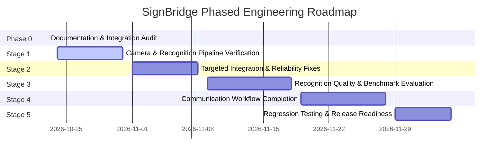

# SignBridge — Phased Implementation Plan & Development Roadmap

**Document Version:** 1.0.0  
**Status:** Active Planning Baseline  
**Product:** SignBridge — Web-Based Real-Time Two-Way Sign Language Assistant  
**Repository:** `sih` (`Warlord-06/teamname-vellosta`)  
**Audit Date:** October 2026  

---

## 1. Roadmap Overview & Execution Principles

This phased implementation plan provides a structured, verifiable path from the current working prototype to a verified, production-ready assistive communication tool.

### Core Governance Principles:
1. **Verification Before Progression:** No stage shall be declared complete without reproducible test evidence.
2. **Safety & Stability First:** Camera lifecycle handling, WebAssembly memory cleanup, and audio queue safety take precedence over vocabulary expansion.
3. **Ethical Sign Accuracy:** Never substitute non-sign gestures for authentic sign language vocabulary. All additions must be linguistically documented.
4. **Documentation Alignment:** Whenever code or architecture changes occur, `PRD.md`, `ARCHITECTURE.md`, `TASKS.md`, and `CHANGELOG.md` must be updated concurrently.

---

## 2. Stage Breakdown

---

### Phase 0: Documentation & Integration Audit
**Status:** **COMPLETED** (October 2026)

- **Objective:** Establish an accurate, truthful baseline of the codebase, inventory all 36 gestures, document architecture and data flows, and align repository documentation with working code.
- **Prerequisites:** Complete repository inspection, source code audit, script inspection.
- **Tasks:**
  - `P0-1`: Conduct repository-wide architectural and file inventory.
  - `P0-2`: Create `PRD.md` documenting functional/non-functional requirements, status matrices, and scope boundaries.
  - `P0-3`: Update `README.md` to reflect the 36-gesture vocabulary, actual npm scripts, technology stack, and camera troubleshooting.
  - `P0-4`: Create `ARCHITECTURE.md` with verified Mermaid component diagrams, data flows, and mathematical formulas.
  - `P0-5`: Formulate `IMPLEMENTATION_PLAN.md`, `TASKS.md`, `TESTING.md`, and `CHANGELOG.md`.
- **Deliverables:** Complete, synchronized set of 7 core documentation artifacts in repository root.
- **Acceptance Criteria:** Every technical claim supported by source code; zero simulated predictions described as real; all 7 documents present and consistent.
- **Risks:** Discrepancies between documented behavior and physical hardware under unverified conditions.

---

### Stage 1: Camera & Recognition Pipeline Verification
**Status:** **IN PROGRESS (Inspection & Runtime Audit Completed; User Webcam Verification Protocol Ready)**

- **Objective:** Systematically verify webcam initialization, WebGL/WASM execution, 21-landmark tracking accuracy, and MediaPipe GPU/CPU fallback across multiple hardware and lighting environments.
- **Prerequisites:** Phase 0 completion; access to standard webcams and diverse lighting conditions.
- **Tasks:**
  - `S1-1`: Execute camera permission lifecycle matrix (grant, deny, dismiss, revoke while streaming).
  - `S1-2`: Measure and record MediaPipe frame rate (FPS), CPU utilization, and GPU delegate fallbacks across Chrome, Edge, and Firefox.
  - `S1-3`: Verify landmark tracking stability across skin tones, hand sizes, and distances (1 to 4 feet).
  - `S1-4`: Verify memory cleanup: confirm hardware indicator light turns off immediately on `Stop Camera` and hook unmount.
  - `S1-5`: Inspect requestAnimationFrame loop under background tab throttling.
- **Deliverables:** Camera Verification Test Log (`tests/logs/camera_verification.md`) with frame-rate and memory profiles.
- **Acceptance Criteria:**
  - Sustained &ge; 20 FPS on standard desktop hardware without thermal throttling.
  - 100% clean camera release without orphaned media tracks.
  - CPU fallback gracefully recovers if WebGL GPU initialization fails.
- **Risks:** Low-end machines without hardware acceleration may experience lower frame rates (&lt; 15 FPS).
- **Dependencies:** WebRTC `getUserMedia`, MediaPipe Tasks Vision CDN availability.

---

### Stage 2: Targeted Integration & Reliability Fixes
**Status:** **NOT STARTED**

- **Objective:** Address known technical debt, eliminate React effect linter warnings, improve error resilience, and ensure offline asset caching.
- **Prerequisites:** Stage 1 completion and test logs.
- **Tasks:**
  - `S2-1`: Bundle or locally cache MediaPipe WASM and model assets (`gesture_recognizer.task`) in `public/` to remove runtime CDN vulnerability.
  - `S2-2`: Refactor synchronous `setState` calls inside effects in `useSpeechSynthesis.js` and `SignVideoPlayer.jsx` to satisfy React Compiler best practices.
  - `S2-3`: Implement an automated testing framework (Vitest + React Testing Library) and register `npm test` script in `package.json`.
  - `S2-4`: Write unit tests for `signClassifier.js` geometric algorithms (`dist`, `dist3d`, `analyzeHandGeometry`, `classifyHandSign`).
  - `S2-5`: Write unit tests for `signPhrases.js` search and alias matching (`findSignPhrase`).
- **Deliverables:**
  - Configured `vitest.config.js` and passing automated test suite (`npm test`).
  - Clean `npm run lint` report with zero warnings.
  - Offline model loading support.
- **Acceptance Criteria:**
  - `npm test` executes cleanly with 100% pass rate across geometric and search unit tests.
  - Application initializes without active internet if assets are cached locally.
- **Risks:** WASM binary size in repository (~15MB); requires Git LFS or optimized CDN caching strategy.
- **Dependencies:** Stage 1 baseline findings.

---

### Stage 3: Recognition-Quality Evaluation & Improvements
**Status:** **NOT STARTED**

- **Objective:** Benchmark the classification accuracy of all 36 gestures, identify geometric rule collisions, and tune threshold parameters.
- **Prerequisites:** Stage 2 unit test framework.
- **Tasks:**
  - `S3-1`: Build a benchmark test suite with pre-recorded landmark fixtures for each of the 36 gestures.
  - `S3-2`: Compute confusion matrix across similar handshapes (e.g. `Rock on` vs `I love you`, `Number 1` vs `You`, `Peace` vs `Good luck`).
  - `S3-3`: Optimize `TemporalStabilityFilter` thresholds (sliding window size, min votes, cooldown) based on empirical accuracy vs responsiveness trade-offs.
  - `S3-4`: Test two-handed gestures under partial occlusion and asymmetric camera angles.
  - `S3-5`: Validate Hands-Free Action Gestures (Point Left backspace, Pinch space, Fist speak, Stop clear) to prevent accidental text deletion.
- **Deliverables:** Gesture Recognition Accuracy Report (`docs/accuracy_benchmark.md`) documenting per-sign precision and recall.
- **Acceptance Criteria:**
  - Zero critical collisions between everyday signs (e.g. `Yes` never triggers `No`).
  - Hands-Free Action Gestures achieve &ge; 95% intentional trigger rate with &lt; 2% accidental trigger rate.
- **Risks:** Heuristic rules have inherent boundary limits; extreme angles may require custom ML embeddings.
- **Dependencies:** Stage 2 test fixtures.

---

### Stage 4: Communication Workflow Completion
**Status:** **NOT STARTED**

- **Objective:** Acquire verified video assets for Mode B, refine Text-to-Sign presentation, and enhance accessibility features.
- **Prerequisites:** Stage 3 completion.
- **Tasks:**
  - `S4-1`: Source and check in authentic, verified ASL/ISL `.mp4` video clips into `public/videos/` for all supported phrases.
  - `S4-2`: Verify `SignVideoPlayer` playback, loop, replay, and slow-motion controls against real video assets.
  - `S4-3`: Add keyboard navigation shortcuts for all interactive controls (Space to speak, Esc to clear, Left/Right for Trainer).
  - `S4-4`: Implement exported transcript capability (download conversation text as `.txt` or copy formatted summary).
  - `S4-5`: Add high-contrast mode toggle and screen-reader ARIA live regions for confirmed speech outputs.
- **Deliverables:** Complete `public/videos/` directory with verified clips; fully accessible keyboard-driven workflow.
- **Acceptance Criteria:**
  - All 36 phrases in Mode B play authentic sign video clips without fallback errors.
  - Full keyboard accessibility (WCAG 2.1 AA compliant navigation).
- **Risks:** Sourcing authentic, rights-cleared sign language recordings requires verified linguistic consultation.
- **Dependencies:** Linguistic asset verification.

---

### Stage 5: Regression Testing & Release Readiness
**Status:** **NOT STARTED**

- **Objective:** Execute end-to-end regression testing, cross-browser compatibility verification, production bundle optimization, and tag the v1.0.0 release.
- **Prerequisites:** Stage 1 through Stage 4 completion.
- **Tasks:**
  - `S5-1`: Configure Playwright for end-to-end browser testing (Chrome, Firefox, Safari/WebKit).
  - `S5-2`: Perform cross-browser testing across desktop and tablet form factors.
  - `S5-3`: Conduct production build optimization (code splitting, dynamic imports for `PracticeMode` and `AboutModal` to keep chunks under 500 kB).
  - `S5-4`: Perform end-to-end manual smoke test following the judge presentation flow.
  - `S5-5`: Tag and release version `v1.0.0` with updated `CHANGELOG.md` and release notes.
- **Deliverables:**
  - Passing Playwright E2E test suite.
  - Optimized production bundle with all chunks &lt; 400 kB.
  - Tagged `v1.0.0` release.
- **Acceptance Criteria:**
  - Zero failing tests in CI pipeline.
  - Production build clean with no chunk size warnings.
  - Verified deployment on static hosting (Vercel / GitHub Pages).
- **Risks:** WebRTC browser differences on WebKit/Safari.
- **Dependencies:** All previous stages.
