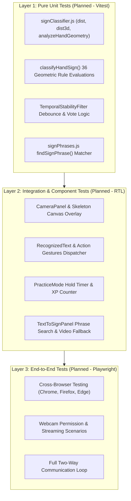

# SignBridge — Testing Strategy & Quality Assurance Guide

**Document Version:** 1.0.0  
**Status:** Baseline Documentation  
**Product:** SignBridge — Web-Based Real-Time Two-Way Sign Language Assistant  
**Repository:** `sih` (`Warlord-06/teamname-vellosta`)  
**Audit Date:** October 2026  

---

## 1. Current Testing Status & Tooling Audit

### 1.1 Existing Tooling Inventory
Inspection of [`package.json`](file:///c:/Users/MANISH%20KUMAR/OneDrive/Desktop/SIH/package.json) confirms:
- **Automated Test Runners:** **None currently installed.** (Neither Vitest, Jest, Cypress, nor Playwright are present in `dependencies` or `devDependencies`).
- **Available Quality Scripts:**
  - `npm run lint`: Executes `oxlint` across repository files to catch syntax errors, unused variables, and React Compiler rules.
  - `npm run build`: Executes `vite build` to perform TypeScript/JSX transpilation and Rollup packaging into `dist/`.
- **Current Automated Test Coverage:** **0% (Unmeasured).**

> [!IMPORTANT]
> **No Fabricated Test Results:**
> In accordance with documentation accuracy principles, SignBridge does not claim fabricated code coverage percentages, simulated benchmark numbers, or non-existent automated test passes. The procedures below represent verified manual smoke-test protocols and the architectural roadmap for introducing Vitest and Playwright in Stage 2 and Stage 5.

---

## 2. Testing Pyramid & Architectural Strategy



---

## 3. Manual Smoke-Test Protocols (Executable Today)

Until automated unit and E2E runners are configured, quality assurance must be conducted via these standardized manual test scripts:

### Protocol A: Camera Permission, Lifecycle & Track Cleanup
| Step # | Action | Expected Behavior | Pass / Fail Criteria |
| :---: | :--- | :--- | :--- |
| **A1** | Load `http://localhost:5173/` in an incognito window. | Camera does **not** activate automatically. Viewport displays "Camera is Currently Offline". | **Pass:** No webcam LED light; zero camera prompts on load. |
| **A2** | Click `Start Camera`. When browser prompts for permission, click **Block** (Deny). | Viewport transitions to "Camera Permission Required" error card with actionable recovery instructions. | **Pass:** Error card displays; retry button is visible. |
| **A3** | Unblock camera permission in address bar and click `Try Again`. | Webcam activates; green status pill shows "Awaiting Hand"; FPS counter reports &ge; 20 FPS. | **Pass:** Video feed appears; FPS counter updates. |
| **A4** | Click `Stop Camera`. | Video freezes/clears; status updates to "Camera stopped"; physical webcam hardware indicator light turns off. | **Pass:** Camera LED turns off immediately; stream tracks stopped. |
| **A5** | Click `Start Camera` &rarr; Navigate to another tab &rarr; Return after 10s. | Stream resumes without freezing or memory accumulation. | **Pass:** Video resumes rendering smoothly. |

---

### Protocol B: Real-Time Hand Detection & Skeleton Overlay
| Step # | Action | Expected Behavior | Pass / Fail Criteria |
| :---: | :--- | :--- | :--- |
| **B1** | Present single hand 2 feet in front of camera lens. | Status pill changes to "Hand in Frame"; HTML5 canvas draws glowing skeleton with distinct colors for Thumb (Amber), Index (Sky), Middle (Emerald), Ring (Violet), Pinky (Pink). | **Pass:** 21 landmark points and 21 bones render over hand. |
| **B2** | Toggle the `Skeleton` button in camera toolbar. | Canvas landmarks hide when toggled off; re-appear when toggled on. | **Pass:** Visual overlay toggles cleanly. |
| **B3** | Toggle the `Mirror` button in camera toolbar. | Video feed and skeleton flip horizontally to match user preference. | **Pass:** Coordinated horizontal flip. |
| **B4** | Present two hands simultaneously. | Status pill displays "2 Hands in Frame"; both skeletons render concurrently. | **Pass:** Simultaneous dual-hand tracking. |

---

### Protocol C: Hand Anatomy Inspector HUD
| Step # | Action | Expected Behavior | Pass / Fail Criteria |
| :---: | :--- | :--- | :--- |
| **C1** | Extend all fingers flat. | HUD pills display `Thumb: Extended`, `Index: Extended`, `Middle: Extended`, `Ring: Extended`, `Pinky: Extended`. | **Pass:** All 5 pills reflect "Extended". |
| **C2** | Make a closed fist. | HUD pills update to `Thumb: Curled`, `Index: Curled`, `Middle: Curled`, `Ring: Curled`, `Pinky: Curled`. | **Pass:** All 5 pills reflect "Curled". |
| **C3** | Make a small pinch (thumb and index tips close). | HUD displays special badge `Pinch: Active 🤏`. | **Pass:** Pinch badge activates. |
| **C4** | Make sign of the horns (index and pinky up). | HUD displays special badge `Horns: Rock On 🤘`. | **Pass:** Horns badge activates. |

---

### Protocol D: Hands-Free Action Gestures
| Step # | Action | Expected Behavior | Pass / Fail Criteria |
| :---: | :--- | :--- | :--- |
| **D1** | Type `"Hello world test"` into text area. Point index finger to the left (👈). | Status detects `Point Left`; glowing banner displays *"⚡ Backspaced last word (Point Left gesture)"*; text buffer changes to `"Hello world"`. | **Pass:** Trailing word deleted without mouse/keyboard. |
| **D2** | Hold small pinch gesture (🤏). | Status detects `A little bit`; glowing banner displays *"⚡ Added space"*; text buffer appends a space character. | **Pass:** Space appended. |
| **D3** | Hold strong fist (✊). | Status detects `Strong`; banner displays *"⚡ Speaking aloud"*; browser vocalizes the sentence through speakers. | **Pass:** Text vocalized aloud. |
| **D4** | Show open palm barrier (✋). | Status detects `Stop`; banner displays *"⚡ Cleared sentence"*; text buffer empties. | **Pass:** Text buffer cleared. |
| **D5** | Toggle `Gesture Actions: OFF` in header. Repeat Point Left. | Sign is processed as the vocabulary word `"Left"` into text buffer rather than performing backspace. | **Pass:** Action execution inhibited when toggled off. |

---

### Protocol E: Speech Synthesis (TTS) Controls
| Step # | Action | Expected Behavior | Pass / Fail Criteria |
| :---: | :--- | :--- | :--- |
| **E1** | Enter `"SignBridge voice test"` &rarr; Click `Speak Text`. | Voice vocalizes text cleanly without clipping; button animates to "Speaking...". | **Pass:** Audio output heard; speaking state visual active. |
| **E2** | Open `Voice Controls` &rarr; Change Speed to `1.25x` &rarr; Click `Speak Text`. | Text is spoken noticeably faster. | **Pass:** Speech rate modifier operates. |
| **E3** | Enable `Auto-speak confirmed signs immediately` &rarr; Confirm sign. | System automatically vocalizes confirmed sign without manual click. | **Pass:** Immediate audio on confirmation. |

---

### Protocol F: Mode B (Text to Sign) & Fallback Verification
| Step # | Action | Expected Behavior | Pass / Fail Criteria |
| :---: | :--- | :--- | :--- |
| **F1** | Switch to `Text -> Sign` tab. Type `"water"` in search input. | Search immediately resolves to `"I need water"`; displays 'W' handshape and chin double tap steps. | **Pass:** Alias resolution successful. |
| **F2** | Inspect video container. | Video element detects missing `/videos/need_water.mp4` file and renders the **Verified Video Awaited** notification without unhandled exceptions. | **Pass:** Graceful missing-video fallback active. |
| **F3** | Test slow-motion pills (`0.5x`, `0.75x`, `1.0x`, `1.25x`). | Active pill updates state; video playback rate modifies accordingly. | **Pass:** Rate state updates. |

---

### Protocol G: Mode C (Gesture Trainer & Quiz)
| Step # | Action | Expected Behavior | Pass / Fail Criteria |
| :---: | :--- | :--- | :--- |
| **G1** | Switch to `Gesture Trainer` tab. | Target sign card displays current challenge (e.g. `Sign 1 of 8: Hello 👋`). | **Pass:** Challenge card loads. |
| **G2** | Make matching sign (or click `Simulate Sign`). | Match progress bar fills from 0% to 100% over 1.0 second. | **Pass:** Visual progress accumulates smoothly. |
| **G3** | Reach 100% hold progress. | Card triggers mastery styling; points increment (+25 XP); streak increments (🔥 1); audio announces mastery; advances to next sign after 2 seconds. | **Pass:** Complete gamified reward cycle. |

---

## 4. Planned Automated Test Architecture (Stage 2 & Stage 5)

### 4.1 Unit Testing Framework (Stage 2 — Vitest)
To be added to `package.json` in Stage 2:
```json
{
  "devDependencies": {
    "vitest": "^2.1.0",
    "@testing-library/react": "^16.0.0",
    "@testing-library/jest-dom": "^6.5.0",
    "jsdom": "^25.0.0"
  },
  "scripts": {
    "test": "vitest run",
    "test:watch": "vitest"
  }
}
```

#### Unit Test File Plan:
1. `tests/unit/geometry.test.js`:
   - Validates Euclidean `dist` and `dist3d`.
   - Validates finger extension thresholds under normal and distorted coordinates.
   - Validates two-hand distance vector calculations.
2. `tests/unit/classifier.test.js`:
   - Validates `classifyHandSign` against pre-recorded synthetic landmark fixtures.
   - Asserts mutual exclusivity (no sign triggers two names simultaneously).
3. `tests/unit/temporalFilter.test.js`:
   - Validates `TemporalStabilityFilter` sliding window, vote thresholds, and cooldowns.
4. `tests/unit/phraseMatcher.test.js`:
   - Tests `findSignPhrase` for exact, ID, alias, and partial substring matches.

---

### 4.2 End-to-End Testing Framework (Stage 5 — Playwright)
Playwright will provide cross-browser testing with virtual fake media streams:
```javascript
// playwright.config.js snippet
use: {
  launchOptions: {
    args: [
      '--use-fake-ui-for-media-stream',
      '--use-fake-device-for-media-stream',
      '--use-file-for-fake-video-capture=tests/fixtures/sample_sign.y4m'
    ]
  }
}
```

---

## 5. Recognition Quality & Accuracy Evaluation Methodology (Stage 3)

### Metric Definitions:
- **True Positive (TP):** Signer performs gesture $G$, and classifier outputs $G$.
- **False Positive (FP):** Signer performs gesture $A$, but classifier outputs $B$ (rule collision), or random motion triggers $G$.
- **False Negative (FN):** Signer performs gesture $G$, but classifier outputs `unrecognized`.
- **Classification Precision:** $\frac{\text{TP}}{\text{TP} + \text{FP}}$
- **Classification Recall:** $\frac{\text{TP}}{\text{TP} + \text{FN}}$

### Protocol H: Empirical Accuracy Evaluation Matrix (Manual Benchmark Protocol)

For manual accuracy evaluation across supported signs, use the following standardized test recording template:

| Test ID | Expected Sign | Hand Pose & Orientation | Hand Detected? | Raw Predicted Label | Confidence | Displayed UI Output | Environmental Conditions | Result (Correct / Incorrect / Inconclusive) |
|---|---|---|:---:|---|:---:|---|---|:---:|
| `ACC-01` | **Hello** | Open palm upright, fingers spread, chest/chin height | Yes | Hello | $\ge 90\%$ | "Hello" appended to buffer | Normal office lighting, facing camera at 2 ft | Pending User Run |
| `ACC-02` | **Yes** | Single hand thumbs-up | Yes | Yes | $\ge 90\%$ | "Yes" appended to buffer | Normal office lighting, facing camera at 2 ft | Pending User Run |
| `ACC-03` | **No** | Single hand thumbs-down | Yes | No | $\ge 90\%$ | "No" appended to buffer | Normal office lighting, facing camera at 2 ft | Pending User Run |
| `ACC-04` | **I Love You** | Thumb, index, and pinky extended | Yes | I love you | $\ge 90\%$ | "I love you" appended | Normal office lighting, facing camera at 2 ft | Pending User Run |
| `ACC-05` | **Peace** | Index and middle extended spread (V-sign) | Yes | Peace | $\ge 90\%$ | "Peace" appended, triggers TTS | Normal office lighting, facing camera at 2 ft | Pending User Run |
| `ACC-06` | **Number 1** | Single index finger pointing straight up | Yes | Number 1 | $\ge 90\%$ | "One" appended | Normal office lighting, facing camera at 2 ft | Pending User Run |
| `ACC-07` | **Rock On** | Index and pinky extended, thumb folded | Yes | Rock on | $\ge 90\%$ | "Rock on" appended | Normal office lighting, facing camera at 2 ft | Pending User Run |
| `ACC-08` | **Namaste** | Two hands pressed together vertically | Yes (2 hands) | Namaste | $\ge 90\%$ | "Namaste" appended | Normal office lighting, facing camera at 2 ft | Pending User Run |
| `ACC-09` | **Neutral / Rest** | Hands dropped to keyboard / resting | No / Yes | `unrecognized` | 0% | No word appended, status stays idle | Normal office lighting | Pending User Run |
| `ACC-10` | **Point Left** | Index finger pointing left | Yes | Point Left | $\ge 85\%$ | Action: Deletes previous word | Normal office lighting, facing camera at 2 ft | Pending User Run |
